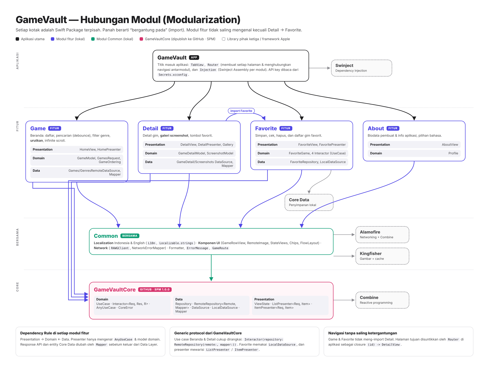

# GameVault

[](https://github.com/fandiaspraja/GameVault/actions/workflows/ci.yml)

Aplikasi katalog gim untuk submission akhir kelas **Menjadi iOS Developer Expert** (Dicoding).
Data diambil dari [RAWG API](https://rawg.io/apidocs), dan gim favorit disimpan dengan **Core Data**.

- SwiftUI · iOS 16+ · iPhone · Bahasa Indonesia & English
- Clean Architecture per modul · Combine · Swinject · Alamofire · Kingfisher
- Modularization dengan Swift Package Manager. Modul Core dipublish di
  [GameVaultCore](https://github.com/fandiaspraja/GameVaultCore).
- CI GitHub Actions: build & test, code coverage, SwiftLint, dan vulnerability scan



---

## Struktur

```
GameVault/
├── App/                     # Aplikasi utama
│   ├── Sources/             # GameVaultApp, Router, AppConfiguration, DI/Injection (Swinject)
│   ├── Resources/           # Assets (ikon, foto profil), Info.plist (dibuat XcodeGen)
│   └── Tests/               # Test DI & navigasi antarmodul
├── Modules/                 # Modul lokal (Swift Package)
│   ├── Common/              # UI bersama, RAWGClient, Localization id/en
│   ├── Game/                # Fitur Beranda: daftar, cari, genre, urutkan
│   ├── Detail/              # Fitur Detail: detail, galeri screenshot, tombol favorit
│   ├── Favorite/            # Fitur Favorit: Core Data
│   └── About/               # Fitur Tentang
├── Config/                  # App.xcconfig + Secrets.xcconfig (API key, tidak di-push)
├── Wireframe/               # Wireframe v1, v2, dan diagram modul
├── .github/workflows/ci.yml # Continuous Integration
└── project.yml              # Spesifikasi XcodeGen
```

Setiap modul fitur berisi tiga layer: **Data → Domain ← Presentation**. Layer-layer itu
memakai *generic protocol* dari GameVaultCore (`UseCase`, `Repository`, `DataSource`,
`LocalDataSource`, `Mapper`, `Interactor`, `ListPresenter`, `ItemPresenter`).

---

## Menjalankan proyek

```bash
brew install xcodegen swiftlint          # sekali saja
cp Config/Secrets.example.xcconfig Config/Secrets.xcconfig   # lalu isi API key RAWG
xcodegen generate
open GameVault.xcodeproj
```

Pilih simulator iPhone, lalu tekan **⌘R** untuk menjalankan aplikasi dan **⌘U** untuk test aplikasi.
Test tiap modul bisa dijalankan dengan memilih scheme `Common`, `Game`, `Detail`, `Favorite`,
atau `About`, lalu tekan **⌘U**.

---

## Fitur

| Halaman | Isi |
|---|---|
| Beranda | Daftar gim, pencarian (debounce 500 ms), filter genre, **urutkan** (baru), infinite scroll, pull-to-refresh |
| Detail | Info lengkap, Metascore, **galeri screenshot layar penuh** (baru), tambah/hapus favorit + toast |
| Favorit | Daftar dari Core Data, geser untuk hapus, empty state |
| Tentang | Biodata, info aplikasi, **pilihan bahasa** (baru) |

Lisensi: MIT.
